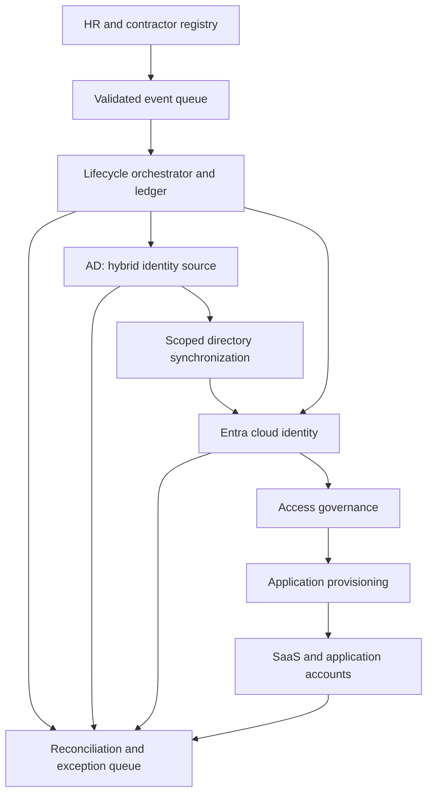
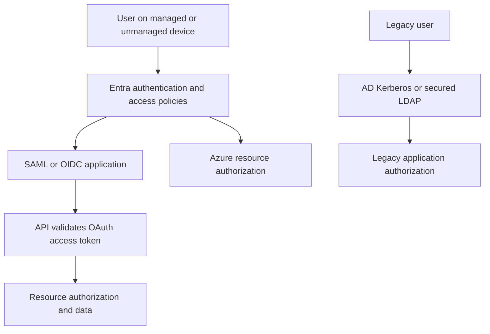

# NorthStar Enterprise IAM & Zero Trust Architecture
Author: Guy Diangana | 12 October 2026 | Version 1.0
Status: Architecture design complete; enterprise deployment and acceptance tests pending.
Self-directed fictional enterprise case study. No Costco architecture, data, or production claims.

## Executive brief
NorthStar is a fictional Canadian hybrid enterprise with 5,000 employees and 500 contractors. This architecture modernizes identity governance while retaining AD-dependent applications. HR establishes employment state, an identity orchestration service controls lifecycle transitions, AD remains authoritative for synchronized legacy identities, and Entra supplies cloud authentication and governance. Applications enforce their own authorization. Privileged access, workload identities, and telemetry are designed as distinct control paths.

The engineering foundation is the existing NorthStar Entra Free lab. This extension supplies requirements, flows, trade-offs, failure handling, threat modelling, and acceptance criteria. It does not deploy licensed enterprise features or claim measured business outcomes.

## 1. Evidence baseline and boundaries
Reviewed the repository README and completion matrix on 12 October 2026:
https://github.com/gdiangana-alt/northstar-identity-zero-trust

| Capability | Existing repository evidence | This extension |
|---|---|---|
| Users/groups and scoped Azure RBAC | Implemented lab controls | Enterprise ownership and role model |
| Blob ABAC condition | Container-scoped lab example | Resource-specific authorization design |
| Security Defaults / Authenticator | Configured in Entra Free | Conditional Access transition design |
| Managed identity | Created with Reader assignment | Runtime authentication and data-plane access remain untested |
| Leaver scenario | Removed one employee group membership | Full account/session/application termination design |
| Audit logs | Successful group-removal event | End-to-end audit correlation design |
| Sign-in logs | Previously access constrained | Proposed connector and permission validation |
| Terraform identity import | Repository records zero-change plan and PR checks | Existing infrastructure retained |
| AD synchronization, HR integration, SCIM, PIM, access reviews | Not established by this lab evidence | Proposed architecture only |

Repository documentation was inspected; existing screenshots and live Azure state were not revalidated in this session. An Azure Policy classification tag is a governance guardrail, not a universal mandatory data-access control. Removing one group is not complete offboarding. A Reader role does not establish workload data access.

## 2. Scenario, assumptions, and ownership
Assumed application inventory: M365; finance SaaS supporting SAML and SCIM; custom web/API applications supporting OIDC/OAuth; legacy Windows applications using Kerberos; selected LDAP clients; Azure application workloads. Exact vendors, connector support, licenses, retention obligations, and directory topology require discovery before deployment.

HR owns employee identifiers, start/end dates, department and manager. Procurement and a named sponsor own contractor status and expiry. IAM owns mappings and orchestration. Application owners own entitlement definitions and termination confirmation. Security owns Conditional Access standards, privileged policy and detections. Privacy/legal approve retention and residency. Service desk verifies recovery requests using approved identity-proofing procedures.

Use a stable internal person identifier for correlation, never email as the durable key. Contractor records cannot be created from arbitrary self-service input. Separate HR data from privileged identity records. Scope synchronization to approved OUs; exclude emergency/cloud-only administrator identities.

Design targets below are fictional business acceptance goals, not achieved results: urgent termination block in both AD and Entra within 15 minutes; downstream revocation within 60 minutes where connectors support it; 95% standard joiners ready by start time; daily entitlement reconciliation; quarterly standard access reviews and monthly privileged reviews. Each application must declare session revocation and residual token limitations.

## 3. Requirements and traceability
| ID | Business requirement | Architecture control | Acceptance test |
|---|---|---|---|
| IAM-01 | Authoritative identity sources | HR/sponsor feed, immutable correlation key | T01 |
| IAM-02 | Controlled JML | Durable events, idempotent orchestration, reconciliation | T02–T04 |
| IAM-03 | Central cloud authentication | Entra SSO with legacy exceptions | T05 |
| IAM-04 | Strong authentication | Authentication strengths, device/context policies | T06 |
| IAM-05 | Least privilege | Scoped RBAC, supported ABAC, role catalogue | T07 |
| IAM-06 | Privileged governance | Separate admins, PIM, AD PAM/JEA boundaries | T08 |
| IAM-07 | Access governance | Access packages, approvals, expiry, reviews, SoD | T09 |
| IAM-08 | Hybrid continuity | AD source ownership, scoped sync, PHS design | T10 |
| IAM-09 | Standards integration | Protocol selection and application adapters | T05/T11 |
| IAM-10 | Workload identity | Managed identity or bounded federation | T12 |
| IAM-11 | Monitoring | Entra/AD/app telemetry to Sentinel | T13 |
| IAM-12 | Auditability | Correlated event ledger and owner acknowledgements | T14 |

## 4. Current and target state
Current fictional enterprise: manual HR tickets; AD-dependent apps; uneven MFA; direct access grants; standing admin privileges; independent SaaS accounts. These are scenario assumptions, not findings from Costco or the lab.

### Identity lifecycle and trust boundaries

The direct orchestrator-to-Entra path serves cloud-only populations and explicit urgent cloud blocking. It must not compete with AD ownership of synchronized profile attributes. Governance determines approved entitlement; provisioning changes target accounts. Neither replaces runtime authorization.

### Runtime access

Trust boundaries are source systems, privileged orchestration, directory synchronization, cloud identity, application runtime, and security telemetry. Validate and authenticate every boundary; signed tokens do not make their claims automatically sufficient for access.

## 5. Joiner–Mover–Leaver and governance
### Joiner
1. Validate unique person ID, approved employment/sponsor state, manager, start date and expiry.
2. Create disabled pre-start account in the correct authoritative directory. Bind source ID to directory ID in the ledger.
3. Assign minimal birthright groups from controlled attributes. Finance/payment entitlements require application-owner approval and SoD evaluation.
4. Provision apps through supported connectors. Record per-target acknowledgement; retry transient faults with backoff.
5. At start time, enable account and complete approved authentication enrolment. No privileged role is a birthright.
6. Reconcile desired versus actual entitlements; alert on missing or excess grants.

### Mover
Version the source event; calculate desired access and explicitly identify removed access. Remove incompatible old entitlements before granting sensitive new roles. Temporary overlap needs named owner, expiry and risk approval. Recheck SoD and application sessions. A changed department must not leave old finance access behind.

### Leaver
Urgent events use a high-priority lane independent of normal sync scheduling. Disable AD and explicitly block Entra sign-in, revoke supported sessions, remove eligible/active privilege and governed entitlements, disable SCIM/local accounts, revoke application sessions/API credentials where supported, rotate shared secrets the person knew, and invalidate delegated external access. Retain records subject to approved legal hold/retention.

Entra blocking or refresh-token revocation does not instantly invalidate every existing application session or access token. Each application must document enforcement, expiry and manual kill-switch. Mark offboarding complete only after acknowledgements or an owned exception; a timeout opens an incident.

### Orchestration invariants
Event key = person ID + source version + event type. Persist before execution. Retries may not duplicate accounts or regrant access after termination. Terminal leaver state supersedes earlier joiner/mover events. Rehire creates an explicit approved transition, not automatic replay. Dead-letter events have an owner and deadline. Daily reconciliation detects drift and orphaned access; deleting an HR record never silently deletes audit history.

### IGA model
Catalogue access packages with owner, resource, rationale, approval route, duration and review schedule. Contractors require sponsor and automatic expiry. Reviewer non-response for sensitive access results in removal after warning/escalation; low-risk treatment is documented separately. Enforce a finance SoD rule: payment creation and payment approval cannot coexist without a time-limited compensating-control exception. Check direct assignments as well as packages; package approval alone cannot detect all external grants.

## 6. Authentication, federation, and hybrid identity
| Protocol | Purpose | NorthStar use and constraint |
|---|---|---|
| OIDC | User authentication | New web/mobile apps; authorization-code flow with PKCE where appropriate; validate issuer, audience, signature, nonce and redirect URI |
| OAuth 2.0 | Delegated/application API authorization | Narrow scopes/app permissions; API validates access token and resource permission; ID token is not an API credential |
| SAML 2.0 | Federation/SSO | Compatible enterprise SaaS; exact audience/recipient, signed assertions and certificate rollover |
| SCIM 2.0 | Account/group provisioning | Supported SaaS; connector credential protection, deletion/disable semantics and reconciliation |
| Kerberos | AD domain authentication | Legacy Windows dependencies; reduce NTLM and separate privileged tiers |
| LDAP | Directory access | Legacy clients only; TLS, validated certificates and constrained bind account; no anonymous/simple cleartext binds |

Select scoped AD-to-Entra synchronization and password hash synchronization (PHS) as the design baseline for hybrid users. Cloud authentication reduces dependency on a running on-prem authentication agent during each cloud password sign-in. Assess forest topology, required attributes, source anchors, staging/recovery, and supported sync product before selection. No unconstrained bidirectional sync. Cloud-native employees can be introduced later only with explicit source-ownership changes.

Pass-through authentication is an alternative where justified on-prem policy needs outweigh runtime availability dependencies. Federation is retained only for a documented requirement; it adds signing-key and service availability risk. Legacy applications still rely on AD even if cloud authentication remains available.

Conditional Access policies are proposed: phishing-resistant methods for admins and sensitive apps; block legacy authentication after dependency assessment; require appropriate managed-device/app protection controls; apply risk policies where licensed; isolate pilot groups and explicit exclusions. Start in report-only, validate representative personas, then enforce in rings. Security Defaults is the current lab baseline; enterprise CA replaces that baseline through a planned cutover, not an assumed combination.

## 7. Authorization and privileged access
| Persona | Target access | Boundary |
|---|---|---|
| Employee | Approved baseline SaaS | No Azure admin rights |
| Developer | Development resource/data roles | No standing production Contributor |
| SOC analyst | Security/log reader scopes | Response actions separately approved |
| Cloud operator | Eligible scoped resource role | PIM activation and expiry |
| Finance requester | Payment initiation | Cannot approve own payments |
| Contractor | Sponsored time-bound package | No inherited employee birthright |
| Workload | Required service/data action | Distinct identity per environment |

Entra directory roles, Azure RBAC roles and application roles are separate systems. Use explicit scope and data-plane permissions. Azure ABAC refines supported operations; it is not a generic attribute policy engine for every Azure service. Govern the provenance and change permissions of attributes that influence access.

PIM manages eligible Entra/Azure roles where supported: authentication, justification, independent approval for high-risk roles, time-bound activation, logs and reviews. Proposed default maximum activation: one hour for high-risk administration, four hours for routine scoped operations. Policies are fictional design settings pending pilot verification.

PIM is not a complete PAM solution for domain controllers, vaulting or arbitrary legacy sessions. AD administration requires tier separation, dedicated admin identities, hardened administrative endpoints, constrained remoting/JEA where applicable, and a compatible PAM/vault/session solution if requirements demand it. No browsing/email on privileged identities. JIT controls duration; JEA constrains actions.

Maintain at least two cloud-only emergency administrator accounts with independent phishing-resistant credentials and secure custody. Design exclusions specifically to avoid dependence on the controls they recover; alert on every use and test recovery quarterly. This is a tightly governed resilience exception to the eligible-privilege default. Do not synchronize these accounts from AD.

## 8. Workload and service identities
Azure-hosted workloads use supported managed identities with minimum management/data permissions. Prove token acquisition and both allowed and denied resource operations; identity creation alone is insufficient.
GitHub deployment uses OIDC federation bound to the exact repository/environment/subject and audience, protected deployment environments and restricted roles. Separate build, deployment and runtime identities; deny untrusted PR token access.
Non-Azure apps use supported workload federation; otherwise use certificates with protected private keys, explicit owner, expiry alerts and automated rotation. Secrets are an exception stored in Key Vault and never source code. Kerberos-dependent Windows services may use gMSA where supported. Inventory every identity, owner, permission, credential, last use and review date. User MFA policy does not govern every service principal; workload controls are separate.

## 9. Threat model and control mapping
Risk ranks are qualitative design judgements before testing.
| Threat | Impact/rank | Controls | Residual risk |
|---|---|---|---|
| Phished password or token theft | Account takeover / High | Phishing-resistant authentication, device policies, session response | Stolen active sessions; app enforcement differences |
| HR feed tampering | Unauthorized provisioning / High | Authenticated integration, field validation, source versions, reconciliation | Trusted-source compromise |
| Sync service compromise | Directory/cloud escalation / Critical | Hardened sync host, scoped permissions, protected admin tiers, monitoring | Highly privileged connector remains sensitive |
| Stale access after mover/leaver | Data access / High | Desired-state diff, urgent blocking, per-app acknowledgement | Unsupported local accounts and sessions |
| Role/attribute manipulation | Privilege escalation / High | Role catalogue, attribute ownership, SoD, privileged approvals | Admin compromise |
| OAuth consent abuse | Persistent delegated access / High | Governed consent, app permission review, credential change alerts | Third-party app breach |
| CI/CD trust misconfiguration | Cloud deployment compromise / High | Bounded federation claims, protected environments, least privilege | Trusted runner/repository compromise |
| Service credential exposure | Lateral access / High | Managed identities/federation, vault/rotation exceptions | Excess workload permissions |
| Identity policy outage | Workforce lockout / High | Pilot rings, tested emergency access, rollback runbook | Cloud identity provider outage |
| Missing/tampered telemetry | Delayed detection / High | Connector health, independent retention, restricted log access | Ingestion delays and partial source coverage |

Conceptual CISSP connections: Domain 1 risk/ownership; Domain 3 boundaries and resilience; Domain 4 protected integration paths; Domain 5 lifecycle/federation/privilege; Domain 6 acceptance testing; Domain 7 monitoring/recovery; Domain 8 workload/CI security. This is a learning map, not a certification claim or compliance attestation.

## 10. Monitoring and audit
Proposed sources: Entra sign-in/audit and supported risk/PIM/provisioning events; AD security events through an approved collector; application entitlement/session records; Azure activity and relevant service logs; orchestration ledger. Validate connector prerequisites and licenses instead of assuming all tables are available.

SOC use cases: emergency sign-in; unexpected role activation; new app credentials/consent; repeated provisioning failure; terminated user access; contractor expiry exception; unauthorized source-attribute change. Each rule needs owner, expected event/table, tuning, test fixture, response procedure and health signal. A joiner should not trigger the same response as an unexplained privileged role grant.

Evidence record: pseudonymous person key, source event version, actor/service identity, approved request, approver, entitlement before/after, timestamps, target acknowledgement, exception and closure. Detailed identifiers belong in restricted audit storage; public portfolio uses synthetic data only.
Assumed retention proposal: 90 days searchable and 365 days archived; privacy/legal must approve before implementation. No assertion that Sentinel defaults or current lab retention satisfy it.

## 11. Architecture decision records
| ADR | Decision | Alternative and trade-off | Revisit trigger |
|---|---|---|---|
| 001 | Entra strategic cloud IdP; preserve AD dependencies | Immediate AD retirement rejected due legacy disruption | Legacy estate migrated |
| 002 | AD ownership for existing synchronized users; explicit cloud-only populations | Bidirectional ownership rejected due conflicting updates | Approved cloud-first HR/source migration |
| 003 | PHS design baseline | PTA/federation add runtime dependencies but may meet specific requirements | Authentication/compliance requirement changes |
| 004 | Governed group/role catalogue with limited supported ABAC | Direct grants simpler initially but harder to reconcile/review | New resource authorization capabilities |
| 005 | Native Entra IGA/PIM where requirements and licensing fit | Separate IGA/PAM product may cover more legacy apps but adds integration cost | Connector gap or privileged session requirement |
| 006 | Durable lifecycle events plus periodic reconciliation | Sync-only termination insufficient for urgency and app sessions | Proven connector timing/coverage |
| 007 | Managed identity/federation before stored secrets | Certificates/secrets retained only as owned exceptions | Runtime federation becomes available |
| 008 | Controlled emergency standing privilege | No emergency privilege risks lockout; broad CA exclusions weaken enforcement | Recovery test failure or platform guidance change |
| 009 | Stage enterprise authentication policies in rings | Tenant-wide immediate enforcement risks outage | Pilot evidence supports expansion |
| 010 | Application-specific termination acknowledgement | Entra-only blocking leaves local/session risk | Application enforcement capabilities change |

Decisions are case-study design choices, not approvals from an enterprise architecture board.

## 12. Delivery, cost, and rollback
| Wave | Work | Exit condition |
|---|---|---|
| 0 | Inventory identities/apps/licenses, clean correlation keys, assign owners | Each app declares protocols, entitlements and termination behaviour |
| 1 | Pilot HR events and directory source rules | Duplicate, stale and failed events reconcile correctly |
| 2 | Pilot SSO/provisioning and Conditional Access | Representative access succeeds; prohibited scenarios fail |
| 3 | Governed packages/reviews and privileged controls | SoD/expiry/emergency recovery evidence accepted |
| 4 | Workload identity and SOC integration | Allowed/denied workload tests and detection tests pass |
| 5 | Expand in rings and track control outcomes | Owners accept coverage and residual exceptions |

Before each wave export settings, record version and rollback owner, verify emergency recovery, and pause on lockout or unexplained access expansion. For policy rollback use an emergency identity and the approved prior configuration. For lifecycle rollback stop new writes and reconcile; never blindly replay old events or re-enable terminated identities. A connector outage must preserve urgent manual termination.

Cost model: eligible user population × required identity SKU, governed contractors/guests and feature-specific licensing, provisioning integration hosting, privileged vault/session tooling if selected, log ingestion/retention and operational support. Obtain current vendor quote and validate per-feature entitlements. PIM typically requires Entra ID P2 or ID Governance; Lifecycle Workflows and advanced governance need their applicable entitlement. Conditional Access and risk features have separate licensing prerequisites. The Entra Free lab incurs no new enterprise licensing through this documentation work.

## 13. Acceptance plan — not executed
| Test | Scenario | Expected evidence |
|---|---|---|
| T01 | Duplicate person or unapproved contractor | Rejected event; no duplicate identity |
| T02 | New starter before/on start date | Disabled pre-start; approved access at start; target acknowledgements |
| T03 | Finance mover with incompatible old role | Old role removed; new approval/SoD recorded |
| T04 | Urgent leaver during sync outage | AD and Entra block; application/session actions and exceptions within target |
| T05 | SAML/OIDC login and invalid token | Valid login succeeds; wrong audience/issuer/expired/replayed token rejected as applicable |
| T06 | Admin strong auth / blocked legacy client | Expected challenge/denial and pilot rollback evidence |
| T07 | Allowed and denied RBAC/ABAC operations | Supported permitted action works; out-of-scope data action denied |
| T08 | PIM expiry and legacy admin boundary | Activation approved then expires; AD controls tested separately |
| T09 | Contractor expiry/reviewer non-response/SoD | Removal and independent exception workflow |
| T10 | Directory sync loss and source conflict | Cloud/legacy effects documented; no conflicting profile overwrite |
| T11 | SCIM failure, retry and app-local session | Idempotent retry; target disabled; residual session verified |
| T12 | Workload runtime and malicious federation subject | Minimal authorized operation succeeds; wrong subject/permission denied |
| T13 | Synthetic emergency/privilege event and connector outage | Alert routes to SOC; health alert detects missing feed |
| T14 | Audit reconstruction and restricted data access | Full who/what/why/approval/use/removal chain; unauthorized audit reader denied |
| T15 | Out-of-order leaver then older joiner | Terminated identity remains disabled |
| T16 | Quarterly emergency recovery exercise | Recovery succeeds and is independently audited |

Record test ID, environment, input, expected/actual result, time, sanitized artifact, owner and defect. All execution results remain pending. Documentation review checks requirements/decisions/acceptance coverage; it does not certify production readiness.

## 14. Recruiter and interview evidence
CV-ready wording for the self-directed portfolio:
**Enterprise IAM & Zero Trust Architecture — Designed a hybrid AD/Microsoft Entra target-state architecture for a fictional 5,500-person enterprise, defining authoritative identity sources, JML/IGA, SSO/federation, scoped authorization, privileged-access governance, workload identities and centralized monitoring. Produced identity flows, ten architecture decisions, a threat model and sixteen acceptance scenarios; distinguished existing Entra Free lab controls from proposed licensed enterprise capabilities.**

Portfolio summary: Extended the existing identity lab into an enterprise IAM architecture case study, connecting business requirements to lifecycle, federation, authorization, privileged access, operations and failure recovery. Enterprise controls are designed; deployment tests remain pending.

60-second explanation: “I started with a working Entra identity lab and designed how those controls would scale to a hybrid enterprise. HR owns employment state, AD retains legacy identity dependencies, Entra provides cloud authentication, and governance controls access approvals and expiry. I separated provisioning from runtime authorization and cloud PIM from legacy PAM. The hardest part is termination: blocking Entra alone does not kill every application session, so each target must acknowledge removal. The repository contains the design decisions, threats and tests needed to validate the rollout.”

Interview defence:
- Why retain AD? Legacy application dependencies; retire it against an application migration plan.
- Why PHS? Cloud sign-in resilience with fewer on-prem runtime dependencies; revisit when specific requirements justify alternatives.
- Why not claim PIM deployed? Existing lab uses Entra Free; architecture design and tested implementation are different evidence.
- What fails during an outage? HR/sync/provisioning/SOC paths have separate health checks and manual urgent controls.
- What is the first pilot? A small employee/contractor cohort, one SCIM SaaS, one legacy app, and isolated admin/recovery identities.

## 15. This week's execution status
| Item | Status |
|---|---|
| Enterprise IAM requirements and target-state design | Written |
| JML, federation, authorization, privileged/workload design | Written |
| Threat model, ADRs, rollout and acceptance plan | Written |
| Azure enterprise feature deployment | Not required for design completion; not performed |
| Enterprise acceptance tests | Pending |
| GitHub architecture publication | Publication tracked separately |
| Master CV replacement and live portfolio update | Pending separate artifact/publication work |
| Existing cloud security architecture | Already present in current master CV; avoid duplicating |
| CISSP | Continue daily preparation; no certification completion implied |

## 16. Primary references
Microsoft documentation checked 12 October 2026. Implementation must recheck feature support, connector behaviour and licensing at deployment time.
- Hybrid authentication selection: https://learn.microsoft.com/en-us/entra/identity/hybrid/connect/choose-ad-authn
- Password hash synchronization: https://learn.microsoft.com/en-us/entra/identity/hybrid/connect/whatis-phs
- Application provisioning: https://learn.microsoft.com/en-us/entra/identity/app-provisioning/how-provisioning-works
- Lifecycle for synchronized AD users: https://learn.microsoft.com/en-us/entra/id-governance/lifecycle-workflow-on-premises
- Governance licensing: https://learn.microsoft.com/en-us/entra/id-governance/licensing-fundamentals
- PIM prerequisites: https://learn.microsoft.com/en-us/entra/id-governance/privileged-identity-management/pim-getting-started
- Emergency access: https://learn.microsoft.com/en-us/entra/identity/role-based-access-control/security-emergency-access

